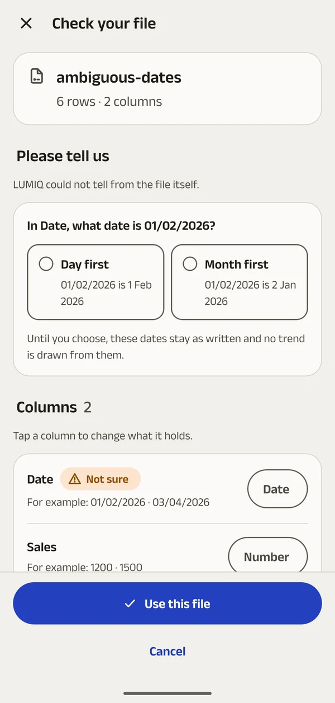
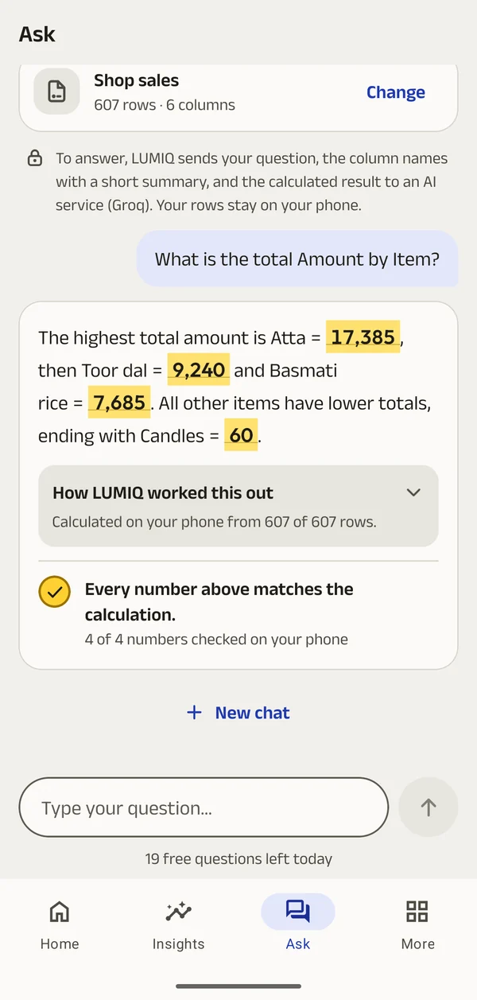
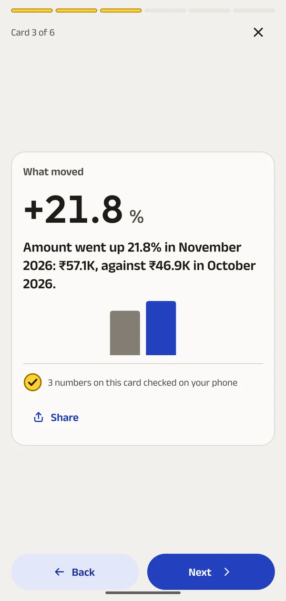
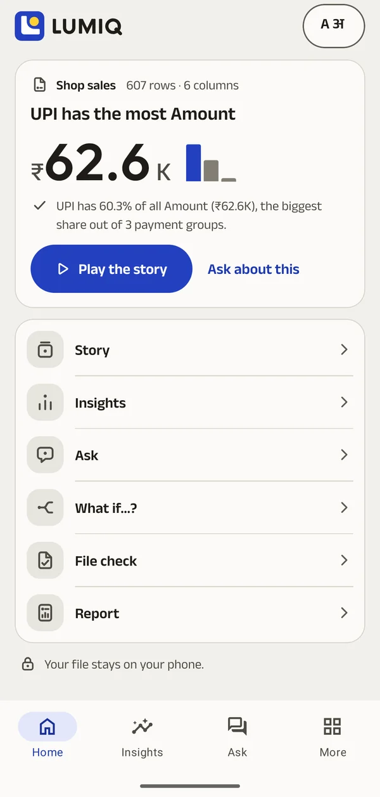
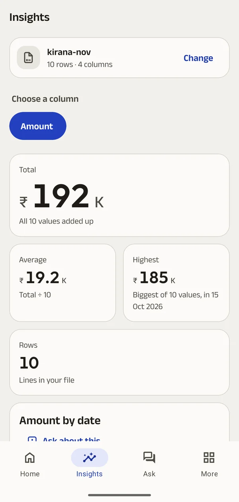
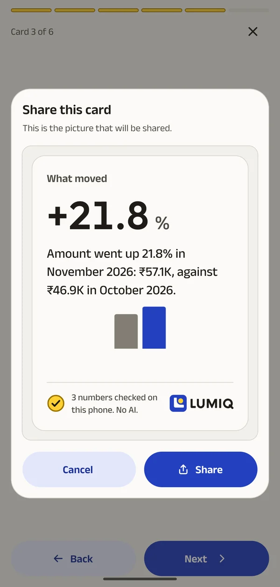
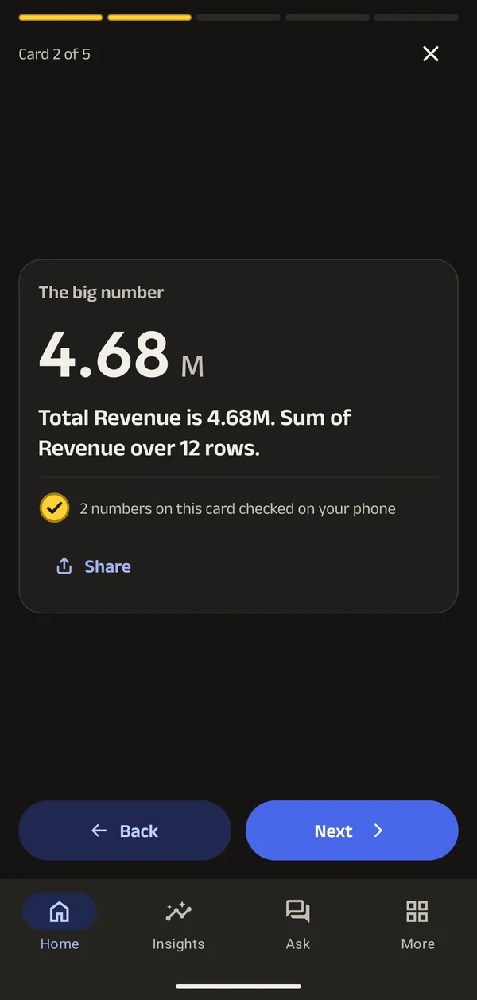

<div align="center">


<br>

<a href="https://github.com/Saksham653/LUMIQ/releases/download/android-v2.0.0/LUMIQ-2.0.0.apk"></a>
&nbsp;
<a href="https://lumiq-android.vercel.app"></a>
&nbsp;
<a href="https://lumiq-silk.vercel.app/"></a>

<br><br>

**Open a CSV or Excel file on your phone and ask it anything.**<br>
LUMIQ works the answer out on your phone, checks every number before it shows you, and keeps your rows on the phone.

</div>

<br>

## See it in 22 seconds

<p align="center">
  
</p>

<p align="center"><sub>The full film with sound plays on the <a href="https://lumiq-android.vercel.app/#film">website</a>.</sub></p>

<br>

## Why LUMIQ

A shopkeeper keeps the month's sales in a sheet. A teacher keeps the fee register in one. Getting a simple answer out of it on a phone ("which item sold the most?", "who still owes fees?") usually means a laptop, a formula, or guessing.

LUMIQ turns that sheet into answers you can read in one glance:

- **Plain questions, real answers.** Type it the way you would say it. The sum, the average, the grouping are calculated on your phone from every row.
- **Every number checked.** Each number in an answer is held against the phone's own calculation and marked when it matches. A number tied to a month or an item has to match that row, not just any value in the table.
- **It reads files the way India writes them.** ₹1,85,000.50, Rs. 480/-, (120) for a return, 13/10/2026. When a date could mean two things, it asks you instead of guessing.
- **Your rows stay on your phone.** No account, no sign-up, no upload of your file.

<br>

## How it works

<table>
  <tr>
    <td width="33%" valign="top">
      
      <h3>1. Open your file</h3>
      Tap a CSV or Excel file in WhatsApp or Files and choose <b>Open with LUMIQ</b>, or open it from the app. Title rows and a "Total" row at the bottom are found for you; unclear dates are asked about.
    </td>
    <td width="33%" valign="top">
      
      <h3>2. Ask in your own words</h3>
      "What is the total Amount by Item?" The answer comes back in a sentence, with each number marked once it matches the calculation: <b>4 of 4 numbers checked on your phone</b>.
    </td>
    <td width="33%" valign="top">
      
      <h3>3. See the story, share it</h3>
      The Story of your file shows what moved, what stands out and how healthy the file is. Send any card to WhatsApp as a picture, with names hidden if you like.
    </td>
  </tr>
</table>

<br>

## It reads your file the way you wrote it

| In your file | LUMIQ reads |
|---|---|
| `₹1,250` | 1,250 rupees |
| `Rs. 480/-` | 480 rupees |
| `1,85,000.50` | 1 lakh 85 thousand and 50 paise |
| `(120)` | minus 120, a return |
| `13/10/2026` | 13 October 2026 |
| `1,5` in a column of `2,75` and `0,9` | one and a half |
| `01/02/2026` | asks you: 1 February or 2 January? |
| `Total` on the last row | left out, so your totals never count twice |

<br>

## Inside the app

<table>
  <tr>
    <td width="25%"><br><b>Home</b><br><sub>What your file is saying, first thing.</sub></td>
    <td width="25%"><br><b>Insights</b><br><sub>Totals, average, highest, each with how it was worked out.</sub></td>
    <td width="25%"><br><b>Share as a picture</b><br><sub>Any Story card, ready for WhatsApp.</sub></td>
    <td width="25%"><br><b>Light and dark</b><br><sub>Follows your phone, or your choice.</sub></td>
  </tr>
</table>

Also in the app: **What if...?** (raise prices 10% and see the new total, file untouched), **File check** (a score out of 100 and the one thing worth fixing first), **Report** (one page to forward, with how each number was worked out), and the whole app in **English and हिन्दी**.

<br>

## Privacy, said plainly

| Never leaves your phone | Sent only when you use Ask, after you allow it |
|---|---|
| Your file and every row in it | The question you type |
| Every sum, average, chart and Story card | Your column names, with a short summary of each |
| File check, What if and Report (all work offline) | The calculated result the answer is written from |

Ask's text goes to LUMIQ's server and the AI service it uses to write the sentence; the numbers in it are then checked against your phone's own calculation. You can say no, and change it any time in More.

<br>

## Download and install

1. Download **[LUMIQ-2.0.0.apk](https://github.com/Saksham653/LUMIQ/releases/download/android-v2.0.0/LUMIQ-2.0.0.apk)** on your Android phone (66 MB, Android 7 or newer, free).
2. Open the file. If Android asks, allow your browser or Files app to install unknown apps.
3. Open LUMIQ and tap **Try with sample data**, or open your own file.

The APK is signed with LUMIQ's own key, so later versions install over it and keep your files. Release notes and the SHA-256 checksum are on the [release page](https://github.com/Saksham653/LUMIQ/releases/tag/android-v2.0.0).

<br>

## Under the hood

<details>
<summary><b>The phone app, the shared engine and the tests</b></summary>

<br>

```
mobile/      the Android app: Expo SDK 58, React Native 0.88, expo-router, TypeScript, Reanimated 4,
             its own design system ("Roshni": paper, one blue for what you press, yellow only on a checked number)
src/         the calculation engine shared by the phone and the web app: reading files, column types,
             plans run on every row, insights, forecast, what-if, file check, the number checker
supabase/    Ask's server function with daily limits per phone and for the whole app
landing/     the website (plain HTML, CSS and JavaScript, deployed on Vercel)
docs/media/  the animations in this README
```

- **One engine, two apps.** The web app and the phone app run the same JavaScript engine (`src/`), with 390 unit tests.
- **Numbers come from code.** Every figure is calculated on the device from all of the rows; language is only used to word a result, and every number in that wording is checked before it is shown.
- **Built for real phones.** The APK is built locally (`assembleRelease`), arm64 and x86_64, and checked on an Android emulator: opening, Home, Story, Ask, file review, Open with LUMIQ.

Run the checks:

```bash
npm install && npm test            # the shared engine and the web app (Vitest)
cd mobile && npm install
npx tsc --noEmit && npx expo lint  # the phone app
npx expo start                     # run it in Expo
```

</details>

<details>
<summary><b>The web app (in the browser)</b></summary>

<br>

LUMIQ also runs in the browser at **[lumiq-silk.vercel.app](https://lumiq-silk.vercel.app/)**: drop in a CSV or Excel file and ask in plain English, with the same rule that every number comes from the calculation. It is React 18 and Vite 5, parses big files in a Web Worker, and keeps your data in the browser.

```bash
git clone https://github.com/Saksham653/LUMIQ.git
cd LUMIQ
npm install
npm run dev      # http://localhost:3000
```

</details>

<br>

## Made by

<table>
  <tr>
    <td></td>
    <td>
      <b>Saksham Srivastava</b><br>
      Designed and built LUMIQ: the phone app, the engine, the website and the film.<br>
      <a href="https://github.com/Saksham653">github.com/Saksham653</a>
    </td>
  </tr>
</table>

Questions, ideas, or a file LUMIQ reads wrong? Write from the [website](https://lumiq-android.vercel.app/#contact) or [open an issue](https://github.com/Saksham653/LUMIQ/issues/new).

<br>

<div align="center">
<sub>Film music: "Follow Me Home" by Arulo (Mixkit). Licensed under the terms in <a href="LICENSE">LICENSE</a>.</sub>
</div>
